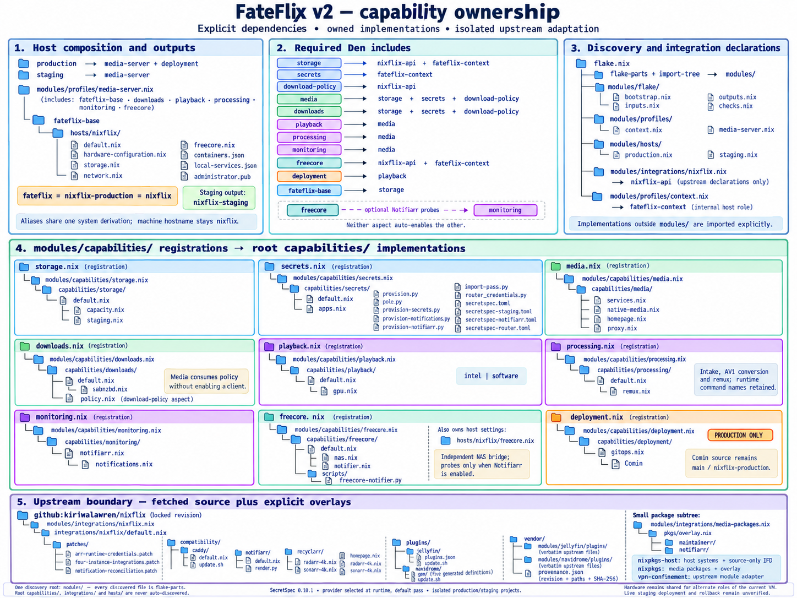
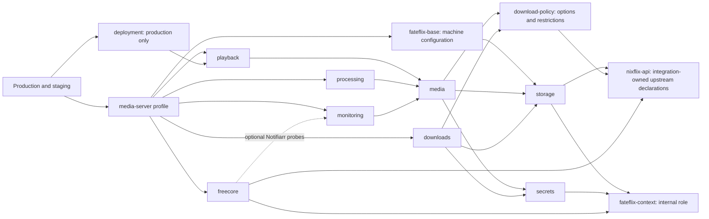

# FateFlix architecture and configuration

FateFlix is a downstream NixOS appliance flake built on pinned
[NixFlix](https://github.com/kiriwalawren/nixflix). It consumes NixFlix as a
flake input and builds a complete host around its media-service modules.
Storage, runtime secrets, download policy, playback, processing, monitoring and
production deployment are composed here, alongside the upstream integration.

## How NixFlix becomes the appliance

1. `modules/flake/inputs.nix` declares `inputs.nixflix` with
   `url = "github:kiriwalawren/nixflix"` and `flake = false`. `flake.lock` pins
   the fetched source; upstream flake outputs are not evaluated.
1. `integrations/nixflix/default.nix` assembles that source with reviewed
   patches, vendored modules, compatibility modules, plugins and packages.
1. `modules/integrations/nixflix.nix` exports the assembled NixOS modules as
   `nixosModules.default` and `nixosModules.nixflix`. The `nixflix-api` aspect
   supplies those declarations to the capability composition.
1. `modules/profiles/media-server.nix` combines the machine base with the
   downloads, playback, processing, monitoring and FreeCORE capabilities.
1. `modules/hosts/` selects production or staging. Production adds the deployment
   capability; `nixosConfigurations.fateflix` exposes the resulting appliance.

The module exports are reusable on another NixOS host. The appliance outputs
include this repository's machine configuration and operating policy. See
[Getting started](getting-started/index.md) to choose between them.

## Composition and host roles

`modules/` is the only import-tree discovery root, and every discovered file is
a flake-parts module. Implementations live outside that root: `capabilities/`
contains owned NixOS modules, `integrations/` adapts dependencies, and `hosts/`
contains explicitly imported machine configuration.

`nixosConfigurations.fateflix` is the preferred production alias. It resolves
to the same derivation as `nixflix-production` and the retained `nixflix` alias;
it is not another Den host. `nixflix-staging` remains the staging output.
Hostnames, state versions, service identities, database locations, image pins,
SecretSpec namespaces and host/media Nixpkgs separation are unchanged.

## Capability ownership

| Aspect | Required aspects |
| --- | --- |
| `nixflix-api` | None; integration-owned upstream option declarations |
| `fateflix-context` | None; internal production/staging role declaration |
| `storage` | `nixflix-api`, `fateflix-context` |
| `secrets` | `fateflix-context` |
| `download-policy` | `nixflix-api` |
| `media` | `storage`, `secrets`, `download-policy` |
| `downloads` | `storage`, `secrets`, `download-policy` |
| `playback`, `processing`, `monitoring` | `media` |
| `freecore` | `nixflix-api`, `fateflix-context` |
| `deployment` | `playback` |
| `fateflix-base` | `storage` |

The downloads capability owns policy declarations separately from activating a
download client. Media can consume protocol policy without including downloads.
Storage can consume upstream declarations without activating media. GPU handling
is internal to playback, including its software mode.

FreeCORE owns `capabilities/freecore/`: `default.nix` declares options,
`nas.nix` contributes probes only when Notifiarr is enabled, and `notifier.nix`
exposes the unchanged NAS bridge payload. Its script lives in the owned
`scripts/` subdirectory. Monitoring does not include FreeCORE, and FreeCORE does
not include monitoring.

The shared machine configuration represents alternate roles of the existing VM,
including the same filesystem UUIDs. A separate staging machine must supply its
own hardware definitions; shared hardware is not evidence of live staging
acceptance. Restored download-path overrides live in the complete `media-server`
profile, not the machine base.

## Configuration

Include an aspect to activate its capability. Options configure its behavior.
The old centralized option modules and activation switches have been removed. Shared host composition lives
in `modules/profiles/media-server.nix`; host-specific choices live in
`modules/hosts/` and `hosts/nixflix/`.

These are NixOS options, available in a composed aspect's `nixos` configuration:

| Owner | Option | Default |
| --- | --- | --- |
| Storage | `fateflix.storage.root` | `/data` |
| Storage | `fateflix.storage.mediaRoot` | `${root}/media` |
| Storage | `fateflix.storage.downloadsRoot` | `${root}/usenet` |
| Storage | `fateflix.storage.capacity` | Existing NAS/root thresholds and probe age |
| Downloads | `fateflix.downloads.incompleteDir` | `${downloadsRoot}/incomplete` |
| Downloads | `fateflix.downloads.completedDir` | `${downloadsRoot}/complete` |
| Downloads | `fateflix.downloads.torrents.allowed` | `false` |
| Downloads | `fateflix.downloads.usenet.allowed` | `true` |
| Playback | `fateflix.playback.acceleration` | `intel` (`software` also supported) |
| Media | `fateflix.media.dashboard` | Existing dashboard preferences |
| Processing | `fateflix.processing.conversion` | Existing CRF, preset, quota and reserve |
| Processing | `fateflix.processing.remux.reserveBytes` | Existing NAS reserve |
| FreeCORE | `fateflix.freecore` | NAS address, interval and timeout |

The shared host profile explicitly overrides incomplete downloads to
`${downloadsRoot}/intermediate` and completed downloads to `${downloadsRoot}/`.
These match the restored SABnzbd state. Startup now reconciles these two settings
to their canonical values. Container-internal paths (including Stash `/data`)
remain separate from host mount paths.

Upstream `nixflix.mediaDir`, `downloadsDir`, SABnzbd's download root and SABnzbd's
`download_dir`/`complete_dir` map to the canonical options. Conflicting upstream
overrides fail evaluation or NixOS assertions, including forced overrides.
Configure the canonical owner instead.

Torrent policy disables torrent clients, integrations, indexer proxies and
unapproved indexers. Production also reconciles restored Arr/Prowlarr state
without deleting records. Staging does not run that reconciliation. Allowing a
protocol permits selected integrations; it does not enable clients by itself.
Omit processing, monitoring or FreeCORE from the profile to omit their optional
behavior. The `freecore` aspect owns its dedicated telemetry module, the existing
SMB/HTTPS checks, and the standalone NAS bridge payload; see
[FreeCORE telemetry](freecore-alerts.md).

## Package policy

`fateflix.packagePolicy` is a **flake-parts option**, not a NixOS option. It is
resolved before constructing the host, media and tooling package sets, so one
policy covers all three without changing their independently pinned inputs.
Unfree packages remain **allowed by default** (`unfree = "allow"`).

A flake-parts module can explicitly restrict that policy:

```nix
{
  fateflix.packagePolicy = {
    unfree = "allowlist"; # "allow", "deny", or "allowlist"
    allowedNames = [ "plexmediaserver" ];
  };
}
```

`allowedNames` uses `lib.getName` (the package's unversioned Nixpkgs name), not a
service name or attribute path. For example, the `plex` service uses a package
named `plexmediaserver`. An empty allowlist permits no unfree packages. `deny`
permits none; `allow` permits all. The list has no effect outside allowlist mode.
Invalid modes and non-string names fail typed module evaluation. Nixpkgs emits
its normal unfree-package error when a selected package is denied: no capability
is silently disabled, substituted or removed. The current media profile selects
Plex, so `deny` requires a deliberate service/profile change before that host can
build. Do not override `nixpkgs.config.allowUnfree` separately in host modules.

The policy does not change runtime service names, state paths, UID/GID values,
secret contracts, storage/download defaults, or public flake output aliases.
Reusable exported upstream NixOS modules still respect the consuming host's own
Nixpkgs policy; this flake-parts setting governs the FateFlix appliance outputs.

## Runtime secrets

The secrets capability owns declarations, installers and operator apps in
`capabilities/secrets/`. App names remain `provision`,
`provision-notifications`, and `provision-notifiarr`. They read the installed
`/etc/nixflix/mode`, refuse unknown roles, and select the namespace before
invoking a provider. Production-only provisioning rejects staging. Direct
installer entry points check the role too.

`SECRETSPEC_PROVIDER` selects a SecretSpec 0.10.1 provider and defaults to `pass`.
The implementation uses `run --file --profile --provider`; it does not use
provider chains or scopes. For example, on the VM:

```sh
nix run .#provision
SECRETSPEC_PROVIDER=keyring nix run .#provision
```

Production keeps project `nixflix`, profiles `default`, `notifications`,
`notifiarr`, `public_tls` and `router_web`, and all credential filenames. Staging
has an independent `nixflix-staging` project with only the application/SMB
`default` profile. It has no inherited production profiles, notification,
Notifiarr, router or deployment credentials. Runtime filenames remain the same;
provider project namespaces separate their values. Staging has no Comin,
production health units, Notifiarr, Apprise container or notification jobs.

Provider output is captured privately; failure prevents installation and errors
suppress credential values. The application installer validates complete input,
uses private permissions, fsyncs a generation and atomically publishes `current`.
Interrupted publication, invalid generations and permission drift retain the
existing recovery behavior. Consumers receive string paths or systemd credential
references. Values are read only at provisioning or service startup.

Router credential resolution also honors the provider and checks the installed
remote role before access. The existing generate-once dashboard password helper
uses `pass`; provision its value in advance when selecting another provider.

## Upstream and updates

`modules/integrations/nixflix.nix` owns upstream imports and adapted source
construction. `integrations/nixflix/default.nix` assembles fetched upstream
source with `patches/`, verbatim `vendor/modules/`, maintained `compatibility/`,
`plugins/` and `pkgs/` overlays. Vendored files record their original revision,
paths and digests in `vendor/provenance.json`. See the
[integration boundary](https://github.com/dales-garage/fateflix/blob/main/integrations/nixflix/README.md). Public `nixosModules.default`, `nixflix`, and
`download-policy` exports are preserved. The source-only IFD remains: evaluation
needs an x86_64 builder to realize the small patched source tree. Prime it with
`nix build --no-link .#lib.nixflixSource` before a read-only flake check.

Input declarations remain in `modules/flake/inputs.nix`. Regenerate `flake.nix`
with `nix run .#write-flake` after editing declarations. Update a dependency only
as an explicit separate change; this refinement preserves `flake.lock`.
Updater allowlists, Renovate paths and CI classification follow the new paths.
Shared integrations, compatibility and dependencies select the full VM suite.
CI retains its bounded planner, pinned action versions and `CI required` gate.
Full flake evaluation always runs; Nix changes build both x86_64 host closures.
VM tests use KVM-capable CI runners.

## Validation and rollout

Run manual evaluation and builds on the NixFlix VM in a temporary checkout.
Run the commands sequentially. Full evaluation and documentation builds can
retain several GiB of memory; cap a full evaluation on this 16 GiB host with
`systemd-run --user --scope -p MemoryMax=9G -p CPUQuota=200% env GC_FREE_SPACE_DIVISOR=16 GC_INITIAL_HEAP_SIZE=104857600 nix flake check --no-build --show-trace`.

```sh
nix build --no-link .#lib.nixflixSource
nix eval --impure --json --file tests/fixture-paths.nix
nix flake check --no-build --show-trace
nix eval .#nixosConfigurations.fateflix.config.system.build.toplevel.drvPath
nix eval .#nixosConfigurations.nixflix-staging.config.system.build.toplevel.drvPath
nix develop --command python3 -m unittest discover -s tests/migration -p 'test_*.py'
nix build --no-link .#nixosConfigurations.fateflix.config.system.build.toplevel .#nixosConfigurations.nixflix-staging.config.system.build.toplevel
python3 scripts/check-secret-canary.py
```

Evaluation and builds create store artifacts while the existing v1 system keeps
running. Activation is separate and remains deferred. No nested VM is required
for these checks. Guest integration tests remain available through CI.

The canary check installs random synthetic values in a private temporary directory
outside the checkout, builds both hosts, and scans built configuration, recursive
derivations and build output for leaks. It never touches production credentials.
`docs/fateflix-v2-baseline.json` records the starting revision, lock digest,
derivations, package versions, identities, storage, credentials metadata and host
contracts. `modules/_support/host-contract.nix` projects the current contracts. See the
[validation record](fateflix-v2-validation.md) for results and remaining acceptance.

Comin continues to poll `dales-garage/fateflix` branch `main`, output
`nixflix-production`. This work performs no activation and changes no production
services or media. Live staging deployment and rollback remain **unverified**
until a separate target is available. Passing repository checks does not make v2
deployment-ready.

## Architecture reference

The expanded graph is retained as an optional implementation reference.

<details markdown="1">
<summary>Expanded capability graph</summary>



The tree follows dependency ownership into subdirectories and files. Solid
capability dependency edges represent required Den `includes`; the optional
FreeCORE/Notifiarr connection does not activate monitoring. Ellipses mark
additional files in a directory.

<details markdown="1">
<summary>Capability dependency graph as text</summary>



</details>

</details>
