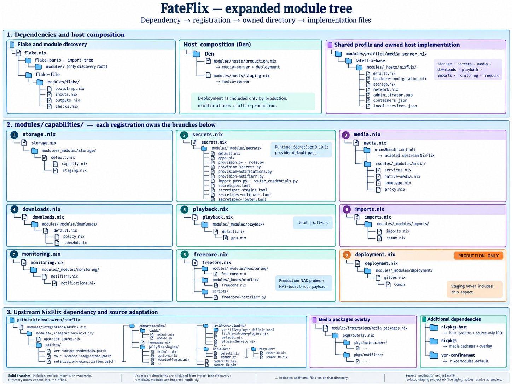
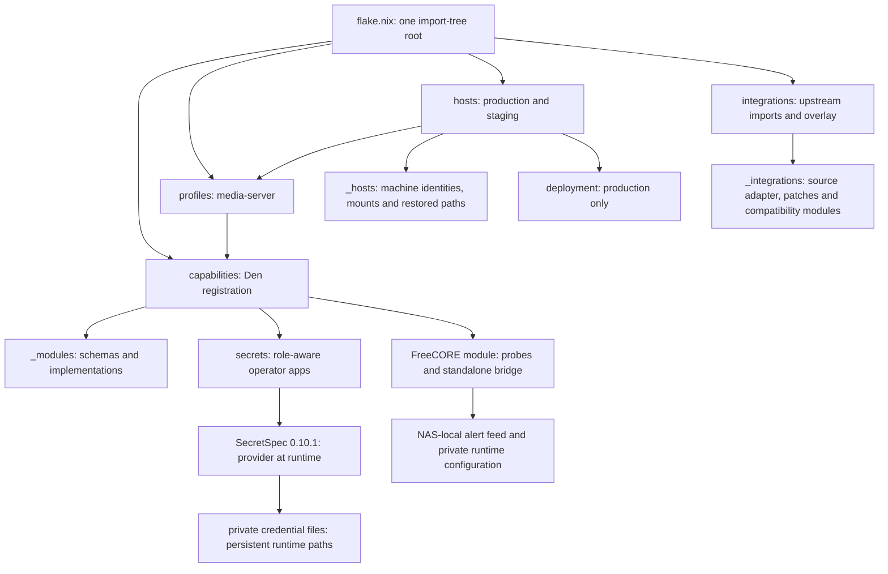

# FateFlix capability ownership

FateFlix is a modular downstream of `github:kiriwalawren/nixflix`. All discovered
files under `modules/` are flake-parts modules. import-tree excludes underscore
paths: NixOS implementations live in `modules/_modules/`, machine configuration
in `modules/_hosts/`, and upstream adaptation in `modules/_integrations/`.



The expanded tree follows each capability registration into its owned
implementation directory and files. The upstream NixFlix branch expands the
patch and compatibility subdirectories. Directory branches show ownership;
nested file branches show imports, such as storage's `default.nix` importing
`capacity.nix` and `staging.nix`. Ellipses mark additional files in a directory.

<details markdown="1">
<summary>Composition relationships as a text diagram</summary>



</details>

Each capability owns its schema, implementation and Den registration. Both hosts
include `den.aspects.media-server`; production additionally includes deployment.
`nixflix` aliases `nixflix-production`. The other output is `nixflix-staging`.
Both retain hostname `nixflix`, their state version, service identities, database
paths, image pins and host/media Nixpkgs separation. The lock is unchanged.

## Configuration

Include an aspect to activate its capability. Options configure its behavior.
The old centralized `modules/options.nix`, `modules/settings.nix`, and their
activation switches are removed without aliases. Shared host composition lives
in `modules/profiles/media-server.nix`; host-specific choices live in
`modules/hosts/` and `modules/_hosts/nixflix/`.

These are NixOS options, available in a composed aspect's `nixos` configuration:

| Owner | Option | Default |
| --- | --- | --- |
| Storage | `fateflix.storage.root` | `/data` |
| Storage | `fateflix.storage.mediaRoot` | `${root}/media` |
| Storage | `fateflix.storage.downloadsRoot` | `${root}/usenet` |
| Storage | `fateflix.storage.capacity` | Existing NAS/root thresholds and probe age |
| Downloads | `fateflix.downloads.incompleteDir` | `${downloadsRoot}/incomplete` |
| Downloads | `fateflix.downloads.completedDir` | `${downloadsRoot}/complete` |
| Downloads | `fateflix.downloads.torrents.allowed` | `false` |
| Downloads | `fateflix.downloads.usenet.allowed` | `true` |
| Playback | `fateflix.playback.acceleration` | `intel` (`software` also supported) |
| Media | `fateflix.media.dashboard` | Existing dashboard preferences |
| Imports | `fateflix.imports.conversion` | Existing CRF, preset, quota and reserve |
| Imports | `fateflix.imports.remux.reserveBytes` | Existing NAS reserve |
| FreeCORE | `fateflix.monitoring.freecore` | NAS address, interval and timeout |

The machine explicitly overrides incomplete downloads to
`${downloadsRoot}/intermediate` and completed downloads to `${downloadsRoot}/`.
These match the restored SABnzbd state. Startup now reconciles these two settings
to their canonical values. Container-internal paths (including Stash `/data`)
remain separate from host mount paths.

Upstream `nixflix.mediaDir`, `downloadsDir`, SABnzbd's download root and SABnzbd's
`download_dir`/`complete_dir` map to the canonical options. Conflicting upstream
overrides fail evaluation or NixOS assertions, including forced overrides.
Configure the canonical owner instead.

Torrent policy disables torrent clients, integrations, indexer proxies and
unapproved indexers. Production also reconciles restored Arr/Prowlarr state
without deleting records. Staging does not run that reconciliation. Allowing a
protocol permits selected integrations; it does not enable clients by itself.
Omit imports, monitoring or FreeCORE from the profile to omit their optional
behavior. The `freecore` aspect owns its dedicated telemetry module, the existing
SMB/HTTPS checks, and the standalone NAS bridge payload; see
[FreeCORE telemetry](freecore-alerts.md).

## Runtime secrets

The secrets capability owns declarations, installers and operator apps in
`modules/_modules/secrets/`. App names remain `provision`,
`provision-notifications`, and `provision-notifiarr`. They read the installed
`/etc/nixflix/mode`, refuse unknown roles, and select the namespace before
invoking a provider. Production-only provisioning rejects staging. Direct
installer entry points check the role too.

`SECRETSPEC_PROVIDER` selects a SecretSpec 0.10.1 provider and defaults to `pass`.
The implementation uses `run --file --profile --provider`; it does not use
provider chains or scopes. For example, on the VM:

```sh
nix run .#provision
SECRETSPEC_PROVIDER=keyring nix run .#provision
```

Production keeps project `nixflix`, profiles `default`, `notifications`,
`notifiarr`, `public_tls` and `router_web`, and all credential filenames. Staging
has an independent `nixflix-staging` project with only the application/SMB
`default` profile. It has no inherited production profiles, notification,
Notifiarr, router or deployment credentials. Runtime filenames remain the same;
provider project namespaces separate their values. Staging has no Comin,
production health units, Notifiarr, Apprise container or notification jobs.

Provider output is captured privately; failure prevents installation and errors
suppress credential values. The application installer validates complete input,
uses private permissions, fsyncs a generation and atomically publishes `current`.
Interrupted publication, invalid generations and permission drift retain the
existing recovery behavior. Consumers receive string paths or systemd credential
references. Values are read only at provisioning or service startup.

Router credential resolution also honors the provider and checks the installed
remote role before access. The existing generate-once dashboard password helper
uses `pass`; provision its value in advance when selecting another provider.

## Upstream and updates

`modules/integrations/nixflix.nix` owns upstream imports and adapted source
construction. Named patches and compatible modules live under
`modules/_integrations/nixflix/`. Public `nixosModules.default`, `nixflix`, and
`download-policy` exports are preserved. The source-only IFD remains: evaluation
needs an x86_64 builder to realize the small patched source tree. Prime it with
`nix build --no-link .#lib.nixflixSource` before a read-only flake check.

Input declarations remain in `modules/flake/inputs.nix`. Regenerate `flake.nix`
with `nix run .#write-flake` after editing declarations. Update a dependency only
as an explicit separate change; this refinement preserves `flake.lock`.
Updater allowlists, Renovate paths and CI classification follow the new paths.
Shared integrations, compatibility and dependencies select the full VM suite.
CI retains its bounded planner, pinned action versions and `CI required` gate.
Full flake evaluation always runs; Nix changes build both x86_64 host closures.
VM tests use KVM-capable CI runners.

## Validation and rollout

Run manual evaluation and builds on the NixFlix VM in a temporary checkout.
Run the commands sequentially. Full evaluation and documentation builds can
retain several GiB of memory; cap a full evaluation on this 16 GiB host with
`systemd-run --user --scope -p MemoryMax=9G -p CPUQuota=200% nix flake check --no-build --show-trace`.

```sh
nix build --no-link .#lib.nixflixSource
nix flake check --no-build --show-trace
nix eval .#nixosConfigurations.nixflix-production.config.system.build.toplevel.drvPath
nix eval .#nixosConfigurations.nixflix-staging.config.system.build.toplevel.drvPath
nix develop --command python3 -m unittest discover -s tests/migration -p 'test_*.py'
nix build --no-link .#nixosConfigurations.nixflix-production.config.system.build.toplevel .#nixosConfigurations.nixflix-staging.config.system.build.toplevel
python3 scripts/check-secret-canary.py
```

Evaluation and builds create store artifacts while the existing v1 system keeps
running. Activation is separate and remains deferred. No nested VM is required
for these checks. Guest integration tests remain available through CI.

The canary check installs random synthetic values in a private temporary directory
outside the checkout, builds both hosts, and scans built configuration, recursive
derivations and build output for leaks. It never touches production credentials.
`docs/fateflix-v2-baseline.json` records the starting revision, lock digest,
derivations, package versions, identities, storage, credentials metadata and host
contracts. `modules/_support/host-contract.nix` projects the current contracts. See the
[validation record](fateflix-v2-validation.md) for results and remaining acceptance.

Comin continues to poll `declarative-dale/nixflix` branch `main`, output
`nixflix-production`. This work performs no activation and changes no production
services or media. Live staging deployment and rollback remain **unverified**
until a separate target is available. Passing repository checks does not make v2
deployment-ready.
